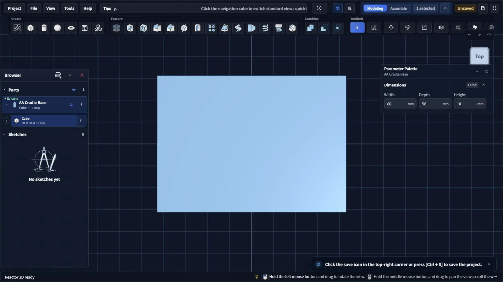
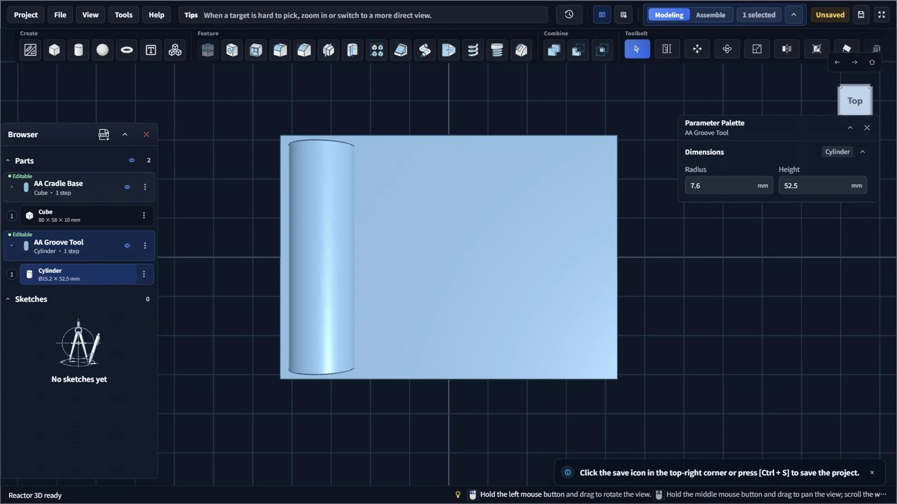
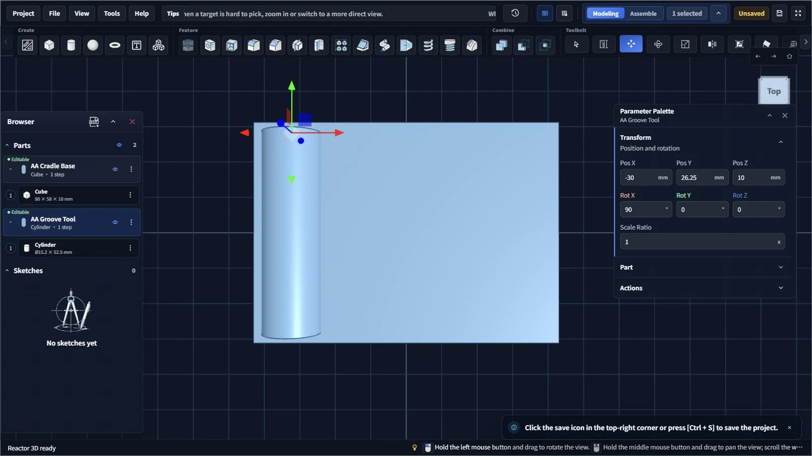
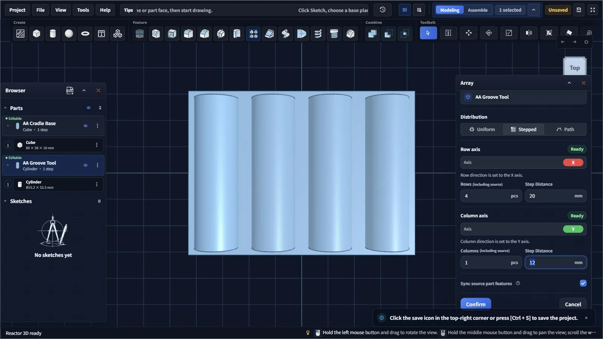
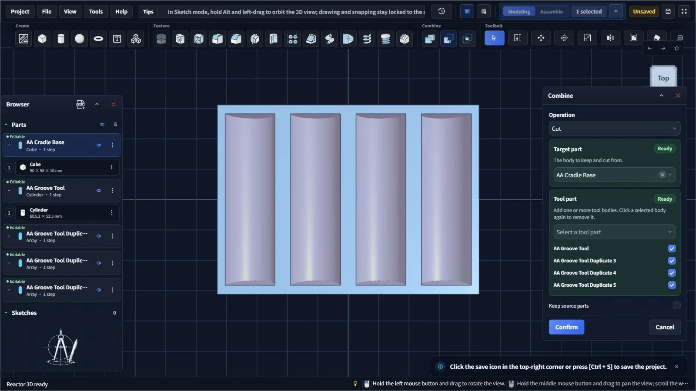
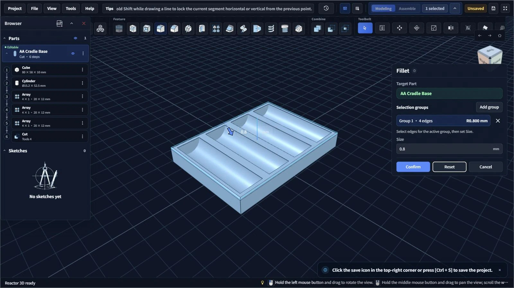

# AA Battery Holder for a Shallow Drawer

*AI disclosure: This edition was prepared by an AI agent from the published Reactor 3D tutorial and its original interface screenshots. No physical printing, cell-fit, drawer-clearance, or durability testing was performed for this edition.*

## Four AA cells, lying flat

Make an 80 × 58 × 10 mm 3D printed battery holder that separates four AA cells in shallow horizontal cradles.

Start with an empty **Solid Model** project in **Modeling**, with English controls and millimeters. This lesson uses a cube, one cylinder, a stepped Array, Cut, and Fillet. The result is one part, with no assembly or electrical contacts.

The cell envelope used here is **14.5 mm diameter × 50.5 mm long**. Measure your own cells before adapting it. A matching cell sits about **16.9 mm above the base bottom** in this geometry; allow at least 20 mm of unobstructed drawer height, then check the first print in the actual drawer. This is a CAD prototype, with physical fit still to be tested.

| Design target | Value |
| --- | --- |
| Base width, depth, height | 80 × 58 × 10 mm |
| Four troughs | Ø15.2 × 52.5 mm long |
| Center spacing | 20 mm along X |
| Nominal floor under a trough | 2.4 mm |
| Closed wall at each end | 2.75 mm |
| Web between troughs | 4.8 mm |

## 01. Size the base block

Choose **Create cube** and place it on the XY grid. Expand its modeling history, select **Cube**, and set **Width 80**, **Depth 58**, and **Height 10 mm**. Choose **Move** and set **Pos X, Y, Z to 0**, all rotations to 0, and **Scale Ratio 1**; name the part **AA Cradle Base**.

## 02. Size the first groove tool

Choose **Create cylinder** and place a separate cylinder on an empty area of the XY grid. Expand its history, select **Cylinder**, and set **Radius 7.6 mm** and **Height 52.5 mm**; name it **AA Groove Tool**. Height becomes the groove’s longitudinal length after the next rotation.

## 03. Lay the cylinder across the top

Select **AA Groove Tool**, choose **Move**, and apply the values below, leaving the scale at 1. The cylinder’s origin is at one end: **Y 26.25** centers its 52.5 mm length between Y −26.25 and +26.25. Its axis lies at the base top, so the lower semicircle removes material while retaining the floor.

| Transform | X | Y | Z |
| --- | --- | --- | --- |
| Position, mm | −30 | 26.25 | 10 |
| Rotation, degrees | 90 | 0 | 0 |

## 04. Array four equally spaced tools

With the cylinder selected, choose **Array → Stepped**. Pick the positive **X** row axis, set **Rows (including source) 4** and **Step Distance 20 mm**, then pick **Y** as the column axis and set **Columns (including source) 1**. Check the four-cylinder preview and choose **Confirm**; column spacing has no effect for one column.

## 05. Cut the four cradles

Select **AA Cradle Base** and choose **Cut operation**. Keep it as **Target part**, add **AA Groove Tool** and all three Array copies as tools, and leave **Keep source parts** off. The preview should show four blind half-round troughs with closed ends; choose **Confirm**.

## 06. Soften the outside upper rim

Choose **Fillet** and select the four straight edges around the base’s **outside top perimeter**. Set **Size 0.8 mm**, check that the group contains four edges, and choose **Confirm**. Keep the groove lips and internal floor edges out of this selection.

## 07. Export the single STL

Choose **File → Export STL**, keep **All visible models** at one model, and choose **Download in browser**. Wait for the export to show **Completed**, then save the single file as `aa-battery-holder.stl`. Keep the flat bottom on the print bed with the open cradles facing upward.

## Adjusting the holder for your cells

The chosen groove diameter adds **0.7 mm total diametral clearance**, or 0.35 mm radially, to the 14.5 mm cell envelope. The 52.5 mm length adds **2 mm total end clearance**. These are starting design choices, not a universal printer allowance or a press fit.

Edit the cylinder radius or length in the project when adapting the fit. Retain material between grooves: the current web is **20 − 15.2 = 4.8 mm**. End-wall thickness is **(base depth − groove length) ÷ 2**; if the length changes, also set the cylinder’s Y position to half that length to keep both end walls equal. Uniform STL scaling changes cell clearance, spacing, and the base together.

## Related modeling lessons

* [Array controls and source-linked copies](https://reactor3d.xyz/en/tutorials/how-to-use-array-solid-model)
* [Boolean Union, Cut, and Intersect](https://reactor3d.xyz/en/tutorials/boolean-operations-union-subtract-intersect)
* [Fillet and Chamfer selection](https://reactor3d.xyz/en/tutorials/fillet-vs-chamfer-online-cad)

## Project files

Download the public [aa-battery-holder.stl](aa-battery-holder.stl) for the finished four-cell holder. The source text mentions an editable RD, but its attachment section currently exposes only this STL. No editable project file is included in this edition. STL does not retain the editable modeling history; keep your own project when following the steps.

## Practical tips for 3D printing

Use a calibrated printer profile and inspect the sliced groove floors before printing. The open-up orientation keeps support material out of the cradles. Print one holder first and check that each cell lifts out freely and the drawer closes without contact. This open rack is for stationary storage; it has no lid, retention clip, charging function, or electrical contacts.

Source: [AA Battery Holder for a Shallow Drawer](https://reactor3d.xyz/en/tutorials/aa-battery-holder), by the Reactor 3D Team, published November 18, 2026. Original instructions and interface screenshots are republished with the site owner's authorization.